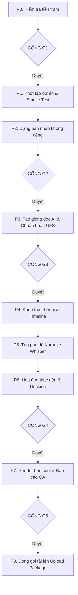

# QUY TRÌNH LẮP RÁP VIDEO TỰ ĐỘNG (REMOTION ASSEMBLY)

> **Mục tiêu:** Tự động hóa toàn bộ quá trình lắp ráp các tài sản video rời rạc (ảnh tĩnh, clip chuyển động, giọng đọc AI, phụ đề karaoke, nhạc nền) thành một video YouTube hoàn chỉnh và chuẩn bị gói đăng tải hoàn thiện theo đúng kế hoạch của Đạo diễn (Stage 3). Quy trình này thuần túy về mặt kỹ thuật, không đưa ra thêm bất kỳ quyết định sáng tạo nào.
> **Vị trí trong luồng:** Chạy sau khi Giai đoạn 3 (First Commit Director) hoàn tất và xuất ra 3 khối dữ liệu bàn giao: `SCENE_PLAN.json`, `PARAMETERS.md`, `SEO.md`.

---

## 1. ĐẦU VÀO & CẤU TRÚC THƯ MỤC DỰ ÁN

### Cấu trúc thư mục đầu vào bắt buộc
```text
project/
  assets/scenes/     # Chứa ảnh S001.png, clip S002_anim.mp4... (đặt tên theo mã cảnh)
  assets/music/      # File nhạc nền: background.mp3
  brief/SCENE_PLAN.json # Bản kế hoạch phân cảnh chi tiết
  brief/SCRIPT.md    # (Tùy chọn) Toàn văn kịch bản đã khóa để đối chiếu
  brief/PARAMETERS.md# Bảng thông số kỹ thuật âm thanh, hình ảnh, phụ đề
  brief/SEO.md       # Dữ liệu xuất bản SEO và công thức tiêu đề, mô tả
```

### Quy chuẩn đặt tên file tài nguyên
- **Cảnh tĩnh:** Đặt tên là `S014.png` (hoặc `.jpg`/`.webp`).
- **Cảnh chuyển động:** Đặt tên là `S014_anim.mp4`.
- **Quy tắc ưu tiên:** Nếu cả `S014.png` và `S014_anim.mp4` cùng tồn tại, ưu tiên dùng file clip chuyển động và bỏ qua file ảnh. Cảnh nào không có cả ảnh lẫn clip là lỗi nghiêm trọng (bắt buộc dừng lại).

---

## 2. QUY TẮC CỐT LÕI & CÔNG CỤ KỸ THUẬT

### Nguyên tắc bất biến (Hard Rules)
1. **Tuyệt đối không can thiệp nội dung:** Không tự ý sửa lời thoại kịch bản, mã cảnh, thứ tự phân cảnh, gán ghép tài sản, hiệu ứng, bảng màu, phông chữ. Không tự thêm hoặc bớt bất kỳ cảnh nào.
2. **Chỉ dùng công cụ cục bộ (Local Tools):** Sử dụng Remotion, ffmpeg, whisper.cpp (qua `@remotion/install-whisper-cpp`) và VieNeu-TTS Python SDK. Tuyệt đối không gọi các API hoặc dịch vụ trả phí bên ngoài.
3. **Bảo vệ tài sản gốc:** Không bao giờ xóa hoặc ghi đè các file gốc của creator trong thư mục `assets/`.
4. **Không tự ý công bố (Never Auto-Publish):** Chỉ chuẩn bị gói xuất bản trong thư mục `upload/` và đặt trạng thái hiển thị mặc định là Private. Creator là người duy nhất xem xét và bấm nút công bố video.
5. **Cơ chế Dừng và Báo lỗi:** Khi phát hiện dữ liệu thiếu sót hoặc xung đột, xuất đúng 1 thông báo và dừng lại:
   ```text
   BLOCKED: <vấn đề cụ thể> | RULE: <điều khoản quy tắc> | OPTIONS: <Phương án A hoặc B>
   ```

### Thư viện hiệu ứng camera cho ảnh tĩnh trong Remotion
Tại mọi khung hình, chuyển động camera kéo dài trọn vẹn thời lượng thực tế của cảnh. Gia tốc chuyển động mặc định: `Easing.inOut(Easing.cubic)` và luôn bật `extrapolateLeft/Right: "clamp"`.

| Tên Preset | Mô tả chuyển động |
|---|---|
| `hold` | Tỷ lệ cố định 1.0, không di chuyển |
| `push_in` | Thu phóng từ `scale_from` (mặc định 1.00) lên `scale_to` (mặc định 1.12), tâm điểm chính giữa |
| `pull_out` | Thu nhỏ từ `scale_from` (mặc định 1.12) về `scale_to` (mặc định 1.00) |
| `pan_left` / `pan_right` | Tỷ lệ cố định `scale` (mặc định 1.10); trục X di chuyển biên độ `travel` (mặc định 3% chiều rộng khung hình) |
| `pan_up` / `pan_down` | Tương tự pan ngang, di chuyển trên trục Y |
| `drift_diag` | Thu phóng từ 1.08 lên 1.14; trục X và Y cùng dịch chuyển 2% theo đường chéo |
| `focus_push` | Đẩy hướng nhìn về tọa độ điểm nhấn `focus_x`, `focus_y` (tính theo % ảnh), thu phóng đến `scale_to` |

> **Quy tắc chống lộ viền đen (Overscan Rule - Bắt buộc):** Ở mọi thời điểm, ảnh phải phủ kín 100% khung hình. Độ dịch chuyển tối đa trên mỗi trục không được vượt quá `(scale - 1) / 2` kích thước khung hình trên trục đó. Nếu thông số vượt quá giới hạn này, tự động điều chỉnh về mức tối đa an toàn và ghi nhận vào báo cáo.
> **Khớp khung hình:** Luôn áp dụng `object-fit: cover` trước khi gắn hiệu ứng. Nếu ảnh không phải tỷ lệ 16:9, dừng lại và báo cáo cảnh lỗi.

---

## 3. QUY TRÌNH THỰC HIỆN: 9 BƯỚC PIPELINE & 5 CỔNG KIỂM SOÁT



### Bước P0: Kiểm tra tiền trạm (Preflight) -> CỔNG G1
1. Quét toàn bộ thư mục `assets/scenes/`, đối chiếu với `SCENE_PLAN.json`:
   - Xác nhận mỗi cảnh có đúng 1 tài sản hợp lệ.
   - Kiểm tra tỷ lệ khung hình ảnh là 16:9.
   - Đọc độ phân giải và tốc độ khung hình (fps) của các clip bằng `ffprobe`.
2. Báo cáo thống kê: Tổng số cảnh, số clip, số ảnh, cảnh bị thiếu tài sản, file lạ thừa, clip ngắn hơn hoặc dài hơn `planned_sec`.
3. **Quét âm thanh clip chuyển động:** Dùng whisper quét âm thanh của từng clip Veo. Nếu phát hiện có giọng nói hoặc khẩu hình xuất hiện trong clip, đánh dấu cảnh đó và áp dụng quy tắc: **Tắt tiếng hoàn toàn (Mute) âm thanh gốc của clip đó.**
4. **DỪNG LẠI tại CỔNG G1.** Chờ creator duyệt `ok` mới được tiếp tục.

---

### Bước P1: Khởi tạo dự án & Kiểm tra nhanh (Project Setup)
1. Tạo dự án Remotion (`bun create video` hoặc `npx create-video@latest`).
2. Cài đặt các công cụ hỗ trợ: `@remotion/install-whisper-cpp`, `@remotion/captions`, VieNeu-TTS.
3. Chuyển tài sản vào thư mục `public/`, tạo thư mục `data/` và `out/`.
4. Chạy kiểm tra nhanh (Smoke-test): Render thử một đoạn video mẫu 2 giây; tạo thử 1 câu thoại bằng VieNeu-TTS; chạy whisper trên câu thoại đó. Ghi nhận thời gian thực thi của cả 3 bước.

---

### Bước P2: Dựng bản nháp không tiếng (Silent Draft) -> CỔNG G2
1. Dựng cấu trúc Sequence từ `SCENE_PLAN.json`: Mỗi cảnh là 1 Sequence theo thời lượng dự kiến `planned_sec`, áp dụng đúng tài sản, hiệu ứng camera (tuân thủ quy tắc Overscan) và hiệu ứng chuyển cảnh (Cut hoặc Crossfade 6 khung hình).
2. Xử lý thời lượng clip chuyển động (Clip Fit):
   - Nếu clip ngắn hơn cảnh: Giữ nguyên khung hình cuối (`hold_last`) cho phần thời lượng còn lại, không thêm hiệu ứng.
   - Nếu clip dài hơn cảnh: Cắt bỏ phần đuôi dư thừa (`trim_end`).
   - Tuyệt đối không thay đổi tốc độ tua nhanh/chậm của clip. Nếu khoảng chênh lệch lớn hơn 2.0 giây, ghi vào báo cáo.
3. Hiển thị chữ trên màn hình (`onscreen_text`) chính xác theo kịch bản, nằm trong vùng an toàn (safe margin).
4. Render bản xem trước không tiếng ở độ phân giải thấp (`out/draft.mp4`, 960x540) cùng 6 khung hình tĩnh tại các điểm chuyển cảnh.
5. **DỪNG LẠI tại CỔNG G2.** Chờ creator xác nhận.

---

### Bước P3: Tạo giọng đọc AI & Chuẩn hóa âm lượng -> CỔNG G3
1. Dùng VieNeu-TTS tạo file âm thanh cho từng cảnh từ trường `tts_text` (hoặc `narration` nếu `tts_text` rỗng) theo đúng cấu hình `VOICE` và `VOICE_SPEED`. Xuất ra thư mục `audio/voice/S###.wav` (mỗi cảnh 1 file).
2. Quy tắc an toàn phát âm: Sử dụng đúng văn bản kịch bản; chỉ đọc theo số và viết tắt đã được phiên âm trong `tts_text`. Nếu lời thoại chứa số mà không có `tts_text`, ghi nhận vào báo cáo để creator kiểm tra.
3. Chuẩn hóa âm lượng toàn bộ file thoại về chuẩn `LOUDNESS_TARGET_LUFS` (-16 LUFS) bằng bộ lọc `loudnorm` của ffmpeg.
4. Đo thời lượng thực tế của từng file audio và lập bảng so sánh với `planned_sec`. Gắn cờ cảnh báo nếu audio dài hơn dự kiến > 1.0 giây hoặc ngắn hơn > 3.0 giây.
5. **DỪNG LẠI tại CỔNG G3.** Creator nghe thử giọng đọc và có thể yêu cầu tạo lại các cảnh cụ thể.

---

### Bước P4: Khóa trục thời gian thực tế (Timing Lock)
1. Tính toán thời lượng chính xác cuối cùng của mỗi cảnh:
   $$\text{Thời lượng cảnh} = \text{SCENE\_LEAD\_SEC (0.2s)} + \text{Thời lượng audio} + \text{SCENE\_TAIL\_SEC (0.35s)}$$
   (Đảm bảo luôn đạt tối thiểu `MIN_SCENE_SEC = 2.5s`, làm tròn lên theo khung hình).
2. Xuất file `data/timeline.json` chứa thông số chi tiết của từng cảnh (khung hình bắt đầu, kết thúc, tài sản, hiệu ứng, file audio thoại).
3. Cập nhật lại quy tắc Clip Fit theo thời lượng mới.
4. Ghi nhận mốc thời gian bắt đầu của từng chương (theo sự thay đổi của các `beat`) để dùng cho phần SEO sau này.

---

### Bước P5: Tạo phụ đề Karaoke khớp từng từ
1. Chạy whisper.cpp trên từng file `S###.wav` để lấy mốc thời gian chi tiết từng từ.
2. **Căn chỉnh chính tả theo kịch bản gốc:** Giữ nguyên mốc thời gian phát âm của whisper nhưng thay thế toàn bộ từ ngữ hiển thị bằng lời thoại đã khóa của kịch bản (không dùng văn bản nhận dạng của whisper để tránh sai chính tả).
3. Căn thời gian phụ đề theo mốc thời gian của cảnh trong timeline. Gom cụm phụ đề tối đa `CAPTION_MAX_WORDS_PER_PAGE` từ mỗi trang.
4. Tô màu từ đang nói bằng mã màu `CAPTION_ACTIVE_COLOR`. Thiết lập thuộc tính `white-space: pre` để bảo toàn khoảng trắng.
5. Xuất file `data/captions.json`. Kiểm tra thử 3 cảnh để đảm bảo độ trễ giữa chữ và tiếng không lệch quá 100 ms.

---

### Bước P6: Hòa âm nhạc nền & Ducking -> CỔNG G4
1. Lồng ghép file nhạc nền `assets/music/background.mp3`. Cắt hoặc lặp nhạc theo tổng thời lượng video, áp dụng fade-in 2 giây ở đầu và fade-out 3 giây ở cuối.
2. Đặt mức âm lượng nhạc nền ở mức `MUSIC_LEVEL_DB` (-22 dB).
3. Kích hoạt tính năng tự động giảm âm lượng nhạc (Audio Ducking) thêm `MUSIC_DUCK_DB` (-8 dB) trong lúc có giọng đọc, với thời gian giảm (attack) 300 ms và thời gian hồi phục (release) 600 ms.
4. Gộp tiếng động (SFX) của các clip ở mức `CLIP_AUDIO_LEVEL_DB` (-14 dB) đối với các clip hợp lệ không bị tắt tiếng.
5. Render bản xem trước có âm thanh (`out/preview_mix.mp4`, 960x540).
6. **DỪNG LẠI tại CỔNG G4.** Chờ creator nghe duyệt tổng thể âm thanh.

---

### Bước P7: Render bản hoàn chỉnh & Kiểm định chất lượng (QA) -> CỔNG G5
1. Render video chính thức `out/final.mp4` ở độ phân giải `RESOLUTION` (1920x1080) và tốc độ `FPS` (30).
2. Chạy quy trình kiểm định chất lượng tự động và lập biên bản `out/QA_REPORT.md`:
   - So sánh tổng thời lượng render với tổng thời lượng timeline.
   - Xác nhận toàn bộ các cảnh xuất hiện đúng thứ tự và không bị thiếu sót.
   - Kiểm tra không có bất kỳ khung hình nào bị lộ viền đen.
   - Quét tìm khung hình đen (black frames).
   - Kiểm tra âm thanh có bị vỡ đỉnh không (Peak âm thanh không vượt quá -1 dBFS).
   - Xác nhận toàn bộ phụ đề nằm trong vùng an toàn (Safe Margin).
   - Đối chiếu từng từ trong phụ đề khớp 100% với kịch bản gốc.
   - Xác nhận các clip có lẫn tiếng đều đã được tắt âm hoàn toàn.
   - Liệt kê toàn bộ các thông số mặc định (DEFAULT) đã sử dụng.
3. Xuất kết quả Pass/Fail cho từng hạng mục. Nếu có lỗi, chỉ rõ mã cảnh bị lỗi để creator quyết định.
4. **DỪNG LẠI tại CỔNG G5.** Chờ creator nghiệm thu bản video cuối cùng.

---

### Bước P8: Chuẩn bị gói tải lên YouTube (Upload Package)
1. Tạo thư mục `upload/` hoàn chỉnh gồm:
   - `video.mp4`: Bản sao của file render hoàn chỉnh.
   - `thumbnail.png`: File ảnh thu nhỏ đã duyệt.
   - `metadata.md`: File thông tin hoàn chỉnh chứa: Tiêu đề chuẩn, mô tả video, tags, danh sách phát, ngôn ngữ, danh mục, và mục mốc thời gian (Chapters) được tính toán tự động chính xác theo dòng thời gian thực tế (chương đầu tiên luôn bắt đầu từ `00:00`).
2. Thiết lập chế độ hiển thị mặc định của video là **Riêng tư (Private)**.
3. Creator tự tải lên và kiểm tra trực tiếp trong YouTube Studio trước khi công bố.

---

## 4. ĐẦU RA CHUẨN & TIÊU CHÍ KHÓA

### Artifacts hoàn thành
- File video hoàn chỉnh: `out/final.mp4`
- Báo cáo nghiệm thu kỹ thuật: `out/QA_REPORT.md`
- Gói tải lên sẵn sàng: Thư mục `upload/` (`video.mp4`, `thumbnail.png`, `metadata.md`)

### Tiêu chí nghiệm thu (Pass Gate)
- Đạt 100% trạng thái PASS trong `QA_REPORT.md`.
- Tuyệt đối không xuất hiện viền đen lộ ra ngoài khung hình ở bất kỳ giây nào.
- Âm thanh thoại rõ ràng, âm lượng tổng thể đạt chuẩn -16 LUFS, không bị méo tiếng (Peak <= -1 dBFS).
- Phụ đề karaoke chạy khớp nhịp đọc và không sai bất kỳ từ nào so với kịch bản gốc đã khóa.
