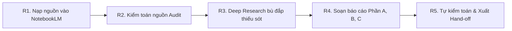

# GIAI ĐOẠN 1: BỘ NGHIÊN CỨU ĐỐI THỦ (RESEARCH KIT)

> **Mục tiêu:** Thu thập và phân tích dữ liệu thực tế từ đối thủ (transcript video, thumbnail, khung hình, bình luận) bằng NotebookLM và Gemini Pro để tạo ra bản **BÁO CÁO TÌNH BÁO ĐỐI THỦ (COMPETITOR INTELLIGENCE REPORT)** có đầy đủ bằng chứng kiểm chứng.
> **Vị trí trong luồng:** Chạy độc lập sau bước R0 của `MASTER_PROMPT.md`. Kết quả dùng làm đầu vào bắt buộc cho Giai đoạn 2 (Channel Architect).

---

## 1. ĐẦU VÀO & CÔNG CỤ

### Đầu vào bắt buộc
- Khối `CHANNEL IDEA` được chốt từ bước R0 của Master Prompt (gồm: ngách, tệp khán giả mục tiêu, ngôn ngữ, vấn đề cốt lõi muốn giải quyết).
- Nếu hành trình người xem chia thành nhiều giai đoạn với nhu cầu khác nhau (ví dụ: người mới bắt đầu vs người đã có tài sản), mỗi giai đoạn phải tạo một notebook nghiên cứu riêng biệt.

### Phân vai công cụ
- **NotebookLM:** Lưu trữ nguồn dữ liệu gốc, đọc transcript và cung cấp trích dẫn chính xác.
- **Gemini Pro (đính kèm Notebook):** Tổng hợp, phân tích chuyên sâu và chạy Deep Research bổ sung dữ liệu.

---

## 2. QUY TẮC CỐT LÕI

1. **Nguyên tắc một nguồn - một tệp:** Mỗi notebook chỉ chứa nguồn cùng một ngách và cùng một tệp khán giả. Không trộn lẫn các tệp đối tượng khác nhau.
2. **Dữ liệu thật, không suy đoán:** Tuyệt đối không tự bịa đặt các chỉ số (lượt xem, CTR, tỷ lệ giữ chân). Thông tin nào không có trong nguồn phải ghi rõ "Không có dữ liệu". Các nhận định suy diễn phải gắn nhãn `[SUY ĐOÁN]`.
3. **Phân tích hình ảnh dựa trên thực tế:** NotebookLM chỉ đọc văn bản (transcript). Việc phân tích hình ảnh bắt buộc phải tải lên ảnh chụp thật (thumbnail và 3–5 khung hình tiêu biểu cho mỗi video nòng cốt) vào nguồn hoặc đính kèm trực tiếp trong chat Gemini.
4. **Cân bằng ngôn ngữ:** Bắt buộc khảo sát cả kênh tiếng Việt và kênh tiếng Anh cùng ngách để học hỏi cấu trúc nội dung quốc tế và đối chiếu với hành vi người xem trong nước.
5. **Ưu tiên kênh nhỏ:** Ưu tiên chọn video từ kênh dưới 500.000 người đăng ký nhưng có lượt xem cao vượt trội so với lượng theo dõi, vì đây là nơi chứa công thức nội dung hiệu quả nhất.

---

## 3. QUY TRÌNH THỰC HIỆN



### Bước R1: Thu thập nguồn (NotebookLM)
1. Tạo notebook mới trên NotebookLM.
2. Nạp từ 8–15 video YouTube đối thủ (kèm đường dẫn transcript đầy đủ).
3. Đính kèm ảnh chụp màn hình: thumbnail và 3–5 khung hình cho từng video tiêu biểu.
4. Nạp 1 file văn bản tổng hợp các bình luận nổi bật của khán giả (nếu có).

---

### Bước R2: Kiểm toán nguồn (Source Audit)
Chạy prompt sau trực tiếp trong khung chat NotebookLM:

```text
Ý TƯỞNG KÊNH (CHANNEL IDEA):
<Điền ngách; tệp khán giả; ngôn ngữ; vấn đề cốt lõi>

Hãy kiểm toán toàn bộ các nguồn trong notebook này dựa trên CHANNEL IDEA. Xuất kết quả bằng tiếng Việt theo cấu trúc sau:

1. BẢNG KIỂM TOÁN:
| Mã | Tiêu đề | Kênh | Ngôn ngữ | Điểm phù hợp (0-5) | Quyết định (GIỮ / CHUYỂN / LOẠI) | Lý do (1 dòng) |
(Điểm phù hợp = Độ khớp khán giả 0-2đ + Độ khớp chủ đề & định dạng 0-2đ + Bằng chứng khả dụng 0-1đ)

2. PHÂN CỤM NGUỒN:
Nhóm các nguồn theo chủ đề và tệp người xem. Đặt tên mỗi cụm tối đa 3 từ và liệt kê các mã nguồn tương ứng.

3. NGUYÊN TẮC TÁCH NOTEBOOK:
Nếu có một cụm nguồn chiếm từ 30% trở lên hoặc phục vụ một tệp khán giả hoàn toàn khác, hãy thông báo: "KHUYẾN NGHỊ TÁCH NOTEBOOK", nêu tên cụm và hướng dẫn chuyển các nguồn đó sang notebook riêng. Không trộn lẫn vào báo cáo này.

4. KHOẢNG TRỐNG TÀI LIỆU (GAPS):
Chỉ rõ những gì còn thiếu để hiểu sâu ngách này (ví dụ: thiếu nguồn tiếng Việt, thiếu video mới dưới 18 tháng, thiếu kênh nhỏ tăng trưởng nhanh, thiếu góc nhìn từ bình luận khán giả, thiếu video thất bại).

5. PHÁN QUYẾT:
ĐỦ (khi có ít nhất 5 nguồn đạt điểm 3 trở lên ở cụm chính) hoặc CHƯA ĐỦ (kèm danh sách chính xác các loại nguồn cần bổ sung).

Toàn bộ đánh giá phải dựa trên nội dung nguồn thực tế. Không tự suy đoán số liệu.
```

> **Hành động:** Nếu có khuyến nghị tách notebook, hãy chuyển nguồn lệch sang notebook khác. Nếu phán quyết là "CHƯA ĐỦ", chuyển sang bước R3.

---

### Bước R3: Nghiên cứu bổ sung bằng Deep Research
Dùng danh sách khoảng trống từ bước R2 để chạy bổ sung nguồn:

#### 3A. Tìm video ứng viên (Gemini Deep Research)
```text
Mục tiêu: Tìm 15-20 video và kênh YouTube để lấp các khoảng trống nghiên cứu sau: <DÁN KHOẢNG TRỐNG TỪ BƯỚC R2>.
Ngách và khán giả: <DÁN CHANNEL IDEA>.

Tiêu chí chọn lọc:
- Bao gồm cả kênh tiếng Việt và tiếng Anh trong ngách.
- Ưu tiên video đăng trong vòng 18 tháng gần nhất.
- Ưu tiên kênh dưới 500k đăng ký nhưng có lượt xem cao đột biến.
- Đa dạng thể loại: kể chuyện (story), giải thích (explainer), hướng dẫn (tutorial), lật tẩy định kiến (myth-buster).
- Tìm thêm ít nhất 3 video có hiệu suất kém hoặc thất bại để làm bài học cảnh báo.
- Loại bỏ: video reup, tổng hợp cắt ghép, kênh rác tạo hoàn toàn bằng AI tự động, bài viết liệt kê sao chép.

Với mỗi video, liệt kê: Tiêu đề, Tên kênh, Đường dẫn (URL), Ngôn ngữ, Thời lượng, Lượt xem & Đăng ký (chỉ ghi nếu thấy rõ), và 1 dòng lý do vì sao video này bù đắp được khoảng trống.
```

#### 3B. Tìm tiếng nói khán giả thực tế (NotebookLM Discover Sources / Deep Research)
```text
Tìm kiếm các cuộc thảo luận, bài viết và diễn đàn nơi người dùng chia sẻ khó khăn thực tế về: <CHỦ ĐỀ NGÁCH>.
Ưu tiên: Các chủ đề thảo luận (Reddit, diễn đàn chuyên ngành), mục hỏi đáp, các phần bình luận dài đa chiều bằng cả tiếng Việt và tiếng Anh.
Tập trung vào: Câu hỏi chính xác họ đặt ra, từ ngữ cảm xúc họ dùng, và những điểm họ cho rằng các video hiện có trên thị trường chưa giải thích thỏa đáng.
```

> **Hành động:** Chọn lọc các nguồn tốt nhất, thêm vào NotebookLM và chạy lại R2 để đảm bảo kho tài liệu đạt chuẩn.

---

### Bước R4: Soạn báo cáo hoàn chỉnh (Gemini Pro)
Mở Gemini Pro, bấm dấu `+` đính kèm Notebook đã hoàn thiện và các ảnh screenshot. Chạy lần lượt 3 phần:

#### Phần A: Bản đồ nguồn & Công thức chiến thắng
```text
Chỉ dựa trên các nguồn trong notebook được đính kèm, hãy viết PHẦN A của BÁO CÁO TÌNH BÁO ĐỐI THỦ bằng tiếng Việt.
CHANNEL IDEA: <Dán ý tưởng kênh>

A1. BẢN ĐỒ KHO NGUỒN (CORPUS MAP):
Liệt kê toàn bộ nguồn được GIỮ lại theo mã V01, V02...: Tiêu đề, Kênh, Ngôn ngữ, Thời lượng, Điểm phù hợp, Vai trò (NÒNG CỐT / BỐI CẢNH / NGOẠI LAI). Nêu danh sách nguồn bị loại và lý do.

A2. CÔNG THỨC CHIẾN THẮNG (WINNING FORMULA - Mã F01, F02...):
Mỗi hàng một phát hiện:
| Mã | Mô hình / Công thức | Bằng chứng (Mã V## + mốc thời gian + trích dẫn tối đa 10 từ) | Độ mạnh (Mạnh: xuất hiện >= 3 nguồn, Vừa: 2 nguồn, Yếu: 1 nguồn) | Phạm vi ngôn ngữ (VI / EN / Cả hai) |

Phân tích toàn diện:
- Dạng câu móc (Hook) và 30 giây đầu tiên (lời hứa, bằng chứng kiểm chứng).
- Cấu trúc mạch dẫn và thứ tự lập luận / kể chuyện.
- Kỹ thuật giữ chân (mở vòng lặp open loops, phá vỡ khuôn mẫu pattern breaks, gọi lại chi tiết callbacks).
- Nhịp độ đọc (từ/phút - chỉ ghi nếu đo được) và nhịp điệu độ dài câu.
- Giọng điệu và nhân vật dẫn chuyện.
- Cách video chạm tới vấn đề cảm xúc sâu xa của người xem.
- Đoạn kết và lời kêu gọi hành động (CTA).

A3. ĐIỂM DỊ BIỆT (DIVERGENCE):
Những điểm các nguồn có quan điểm trái ngược nhau, và sự khác biệt rõ rệt giữa cách làm của kênh tiếng Việt so với kênh tiếng Anh.

Quy tắc: Trích dẫn mã nguồn cho mọi phát hiện. Không bịa đặt số liệu. Đánh dấu [SUY ĐOÁN] nếu là suy luận.
```

#### Phần B: Mổ xẻ chi tiết từng video nòng cốt
```text
Chỉ dựa trên các nguồn trong notebook đính kèm, hãy viết PHẦN B của báo cáo bằng tiếng Việt: Mổ xẻ chi tiết từng video NÒNG CỐT (tối đa 6 video mỗi lượt trả lời).

Với mỗi mã nguồn V##:
- Hook (30 giây đầu): Thể loại hook, lời hứa đưa ra, bằng chứng xác thực, mốc thời gian.
- Cấu trúc nhịp (Beat map): Các phân đoạn chính kèm mốc thời gian.
- Kỹ thuật giữ chân người xem được áp dụng và vị trí xuất hiện.
- Giọng văn: Ngôi xưng, phong cách ngôn ngữ, độ hài hước, nhịp câu; kèm 2 câu trích dẫn mẫu (mỗi câu tối đa 10 từ).
- Quy cách đóng gói (Packaging): Công thức đặt tiêu đề; mô tả thumbnail (chỉ phân tích nếu có ảnh đính kèm, nếu không ghi "Không có ảnh").
- Tuyên bố cần kiểm chứng sự thật: Liệt kê các luận điểm cần kiểm tra tính xác thực trước khi dùng.
- BÀI HỌC CẤU TRÚC NÊN HỌC: Khung sườn và nhịp điệu đáng học hỏi.
- DẤU ẤN CẦN TRÁNH: Những câu từ chữ ký, phong cách riêng biệt của đối thủ tuyệt đối không được sao chép.
- Ngôn ngữ: Điểm khác biệt ngôn ngữ (VI hoặc EN) và những chi tiết không thể dịch nguyên bản.
```

#### Phần C: Ngôn ngữ thị giác, Khán giả, Khoảng trống & Rủi ro
```text
Dựa trên các nguồn và hình ảnh đính kèm trong notebook, hãy viết PHẦN C của báo cáo bằng tiếng Việt:

C1. NGÔN NGỮ THỊ GIÁC (Chỉ phân tích từ ảnh thật, không suy đoán từ transcript):
Phân tích theo từng ảnh: Vai trò (thumbnail / khung hình video / thẻ tiêu đề), bố cục và điểm nhấn mắt, bảng màu (3-5 mã HEX ước tính), phong cách phông chữ, ánh sáng và chất liệu, chuyển động ngụ ý. Tổng kết 5 quy luật thị giác lặp lại nhiều nhất.

C2. TỪ VỰNG KHÁN GIẢ:
Các câu hỏi và cụm từ chính xác mà khán giả thường dùng trong bình luận (cả VI và EN), các từ ngữ bộc lộ cảm xúc mạnh, và những điều họ phàn nàn là video hiện tại chưa giải quyết được (trích dẫn mã nguồn V##).

C3. KHOẢNG TRỐNG NỘI DUNG (Mã G01, G02...):
- Những câu hỏi của người xem mà chưa kênh nào giải đáp thỏa đáng.
- Những góc tiếp cận mới lạ chưa nguồn nào khai thác.
- Những điểm mà đối thủ chỉ mới chạm tới bề mặt vấn đề mà chưa đi sâu vào nỗi đau cốt lõi.
(Với mỗi khoảng trống: Nêu rõ bằng chứng | Áp dụng cho ngôn ngữ nào | Tác động thực tế).

C4. RỦI RO & VÙNG CẤM:
Các tuyên bố cần kiểm chứng trước khi đưa vào kịch bản; các nội dung có nguy cơ gây hại cho người xem (tài chính, sức khỏe, pháp luật); các điểm quá giống đối thủ cần tránh trùng lặp.

C5. CÂU HỎI MỞ CHO CHIẾN LƯỢC GIA:
Tối đa 8 quyết định chiến lược then chốt mà dữ liệu nghiên cứu hiện tại chưa thể tự giải quyết, cần người sáng tạo chốt ở Giai đoạn 2.
```

---

### Bước R5: Tự kiểm toán báo cáo (Gemini Pro)
Chạy prompt sau ngay trong cuộc chat Gemini vừa viết báo cáo:

```text
Hãy đối chiếu toàn bộ báo cáo vừa viết (Phần A, B, C) với kho nguồn trong notebook:
1. Liệt kê mọi phát hiện (F##) và khoảng trống (G##) mà bạn không tìm thấy bằng chứng xác thực trong nguồn, hoặc trích dẫn/mốc thời gian bị lệch. Đánh dấu từng mục: LOẠI BỎ, HẠ MỨC ĐỘ, hoặc ĐÃ SỬA LẠI (kèm dòng thông tin đã chỉnh sửa).
2. Liệt kê bất kỳ số liệu đo lường nào không xuất hiện trực tiếp trong nguồn.
3. Soạn một HAND-OFF HEADER (tối đa 120 từ): Tóm tắt ý tưởng kênh, ngôn ngữ, tổng số nguồn đã dùng (bao nhiêu VI, bao nhiêu EN), và những giới hạn mà báo cáo này chưa thể trả lời.

Chỉ xuất ra 3 nội dung trên.
```

---

## 4. ĐẦU RA CHUẨN & TIÊU CHÍ KHÓA

### Cấu trúc Artifact bàn giao (`research/REPORT.md`)
Ghép theo thứ tự:
1. **HAND-OFF HEADER** (Tổng quan dữ liệu và giới hạn nghiên cứu)
2. **PHẦN A:** Bản đồ nguồn (V##) & Công thức chiến thắng (F##)
3. **PHẦN B:** Mổ xẻ chi tiết từng video nòng cốt
4. **PHẦN C:** Ngôn ngữ thị giác, Từ vựng khán giả, Khoảng trống (G##), Rủi ro & Câu hỏi mở

### Tiêu chí nghiệm thu (Pass Gate)
- Có tối thiểu 5 nguồn nòng cốt đạt điểm phù hợp >= 3.
- Toàn bộ luận điểm chiến lược đều được gắn mã định danh rõ ràng (`V##`, `F##`, `G##`).
- Không có số liệu tự bịa (lượt xem, retention, CTR).
- Đủ bằng chứng thị giác từ ảnh chụp thực tế nếu kênh có định hướng phong cách hình ảnh.
