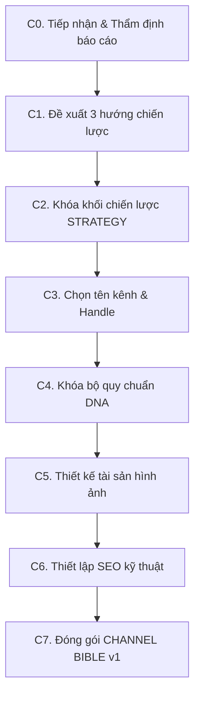

# GIAI ĐOẠN 2: THIẾT KẾ CHIẾN LƯỢC KÊNH (CHANNEL ARCHITECT)

> **Mục tiêu:** Chuyển hóa dữ liệu từ Báo cáo tình báo đối thủ (Stage 1) thành bản quy hoạch chiến lược kênh toàn diện: định vị thương hiệu, tên kênh, bộ quy chuẩn DNA kiểm thử được, thiết kế nhận diện hình ảnh và thiết lập SEO kỹ thuật, sau đó đóng gói thành **CHANNEL BIBLE v1**.
> **Vị trí trong luồng:** Chạy sau khi có `research/REPORT.md` từ Stage 1 (tương ứng với Phase A trong `MASTER_PROMPT.md`). Là kim chỉ nam bắt buộc cho toàn bộ khâu sản xuất video về sau.

---

## 1. ĐẦU VÀO & CÔNG CỤ

### Đầu vào bắt buộc
1. **BÁO CÁO TÌNH BÁO ĐỐI THỦ (Stage 1):** File `research/REPORT.md` đầy đủ các mã V## (video), F## (công thức thắng), G## (khoảng trống).
2. **BẢN YÊU CẦU CỦA CREATOR (Creator Brief):**
   - Mục tiêu kênh (thu nhập, xây dựng uy tín hay cả hai) và mốc thời gian kỳ vọng.
   - Quỹ thời gian sản xuất (số giờ/tuần).
   - Ràng buộc cá nhân: Lộ mặt hay faceless; dùng giọng thật hay AI; ngân sách công cụ.
   - Ngôn ngữ: Tiếng Việt là gốc (kèm ngôn ngữ phụ nếu có kế hoạch mở rộng).
   - Danh sách chủ đề, lời khuyên hoặc hình thức kiếm tiền cấm tuyệt đối (vùng cấm).

### Điều kiện dừng (Stop Condition)
Nếu báo cáo nghiên cứu đối thủ quá mỏng, có sự mâu thuẫn lớn hoặc trộn lẫn các ngách không liên quan, phải dừng lại ngay ở bước C0 để bổ sung nguồn ở Stage 1; tuyệt đối không xây chiến lược trên nền dữ liệu yếu.

---

## 2. QUY TẮC CỐT LÕI

1. **Chốt tên trước mọi thứ:** Tên kênh len lỏi vào DNA, câu mở, câu kết, mô tả, banner, trailer, kịch bản và kế hoạch cảnh. Đổi tên sau này sẽ kéo theo việc phải làm lại toàn bộ chuỗi (Rename Cascade).
2. **Mỗi quyết định đều có phương án và lý do:** Mỗi hạng mục cần đề xuất 2–3 phương án, 1 khuyến nghị rõ ràng kèm lý do ngắn gọn (tối đa 3 dòng) nêu rõ loại bằng chứng nào sẽ làm bạn thay đổi quyết định.
3. **Mọi luận điểm đều gắn với bằng chứng:** Trích dẫn mã F##, G##, V## cho mọi quyết định chiến lược. Nhận định nào không có số liệu phải gắn nhãn `[GIẢ ĐỊNH]`.
4. **Quy tắc thử nghiệm văn nói (Spoken Test):** Tên kênh, câu mở đầu chữ ký, câu kết phải đọc trơn tru, tự nhiên trong một câu nói thông thường. Loại bỏ hoàn toàn các cấu trúc xưng danh gượng gạo (như *"mình là X của kênh Y"*).
5. **Quy tắc vùng cấm & Ngách nhạy cảm:** Trong các ngách tài chính, y tế, pháp lý: chỉ tập trung vào nguyên lý và cơ chế; không khuyến nghị tài sản/sản phẩm cụ thể; mọi số liệu dự phóng phải ghi "giả định" kèm dải biến thiên; không đưa ra lời cam kết kết quả.
6. **Quy chuẩn thực thi cho AI yếu hơn:** Mọi quy tắc trong DNA phải cụ thể và đo lường được (số lượng từ, bảng mã HEX, phông chữ cụ thể) để các agent yếu hơn ở giai đoạn sau có thể tự thực thi chính xác mà không cần tự suy diễn.

---

## 3. QUY TRÌNH THỰC HIỆN

### Bước C0: Tiếp nhận & Thẩm định báo cáo (Intake & Challenge)
1. Tóm tắt các kết luận cốt lõi mà báo cáo Stage 1 đã xác lập (tối đa 10 dòng).
2. Chỉ ra tối đa 5 điểm yếu của dữ liệu (nguồn mỏng, mất cân đối ngôn ngữ, thiếu bằng chứng hình ảnh, thiên lệch kẻ sống sót, mâu thuẫn dữ liệu).
3. Đưa ra phán quyết:
   - **ĐỦ (SUFFICIENT):** Đủ cơ sở để xây dựng chiến lược, tiếp tục sang C1.
   - **CHƯA ĐỦ (INSUFFICIENT):** Chỉ rõ các phần bắt buộc phải bổ sung ở Stage 1 và tạm dừng.
4. Nêu tối đa 3 câu hỏi cho creator nếu câu trả lời làm thay đổi trực tiếp hướng đi chiến lược.

---

### Bước C1: Đề xuất các hướng chiến lược (Strategic Directions)
Đề xuất 3 định hướng chiến lược rõ rệt, mỗi hướng gồm:
- Tuyên bố định vị trong 1 câu (Dành cho ai? Giải quyết vấn đề sâu xa nào? Góc tiếp cận là gì?).
- Khoảng trống thị trường (mã G##) mà hướng này khai thác.
- Thể loại video chủ lực phù hợp.
- Kế hoạch ngôn ngữ và lộ trình kiếm tiền (Monetization).
- Rủi ro chính và ước tính khối lượng công việc mỗi video.
- Đưa ra 1 khuyến nghị lựa chọn để creator phê duyệt.

---

### Bước C2: Khóa khối chiến lược (STRATEGY Lock)
Sau khi creator chọn hướng, hoàn thiện khối `STRATEGY`:
- **Tuyên bố định vị:** 1 câu súc tích.
- **Hành trình người xem:** Các giai đoạn chuyển biến và chỉ số kích hoạt chuyển giai đoạn.
- **Chân dung người xem (Avatar):** 1–2 tệp cụ thể, nêu rõ vấn đề bề mặt và nỗi đau sâu xa.
- **Trụ cột nội dung (Content Pillars):** 3 trụ cột kèm tỷ lệ phân bổ, mỗi trụ cột gắn với một vấn đề sâu xa.
- **Chu kỳ định dạng:** Tỷ lệ luân phiên giữa các thể loại (Story case study, Myth-buster, Deep dive, What-if, Tutorial) trong chu kỳ 10 video.
- **Kế hoạch ngôn ngữ & Bản đồ kiếm tiền:** Nguồn thu thực tế (AdSense, tiếp thị liên kết, sản phẩm số, tài trợ), mốc doanh thu đầu tiên và những gì bị vùng cấm loại trừ.
- **3 tuyên bố giá trị nguyên bản:** Gắn trực tiếp với mã G## chứng minh không sao chép đối thủ.
- **Danh sách 10 tiêu đề video đầu tiên:** Tiêu đề làm việc kèm phân loại trụ cột, định dạng và vấn đề giải quyết.
- **Tiêu chí dừng kênh (Kill criteria):** Các mốc số liệu và ngày tháng cụ thể (ví dụ: *"Sau 15 video, nếu chỉ số X không đạt Y thì thay đổi Z"*).

---

### Bước C3: Đặt tên kênh & Handle (Name & Handle)
Đưa ra 8 phương án tên kênh, mỗi phương án gồm:
- Tên kênh, gợi ý handle và handle dự phòng.
- Công thức cấu trúc tên và ý nghĩa cốt lõi.
- Motif thị giác mà tên kênh gợi mở.
- **Câu kiểm tra văn nói (Spoken-test sentence):** Đặt tên vào một câu nói tự nhiên (không dùng mẫu *"Chào bạn, mình là..."*).
- Đánh giá độ phù hợp với người xem hiện tại và sau 12 tháng.
- Khuyến nghị phương án tối ưu nhất và nhắc creator kiểm tra trùng lặp thực tế trên YouTube trước khi chốt.

---

### Bước C4: Thiết lập bộ DNA kênh (Channel DNA)
Toàn bộ quy tắc trong DNA phải kiểm thử được:
- **VOICE (Giọng nói & Văn phong):**
  - Chân dung nhân vật dẫn chuyện (Persona) trong 1 dòng; góc nhìn trần thuật.
  - Ngôi xưng cố định bằng tiếng Việt (người dẫn xưng là gì, gọi khán giả là gì).
  - Quy chuẩn độ dài câu: Số từ trung bình và số từ tối đa mỗi câu; tối đa số câu trong một đoạn.
  - 3 công thức mở đầu (Hook) kèm mẫu điền sẵn (bắt buộc chứa 1 con số cụ thể hoặc hình ảnh thị giác trong 30 giây đầu).
  - Giọng điệu, mức độ hài hước và danh sách từ ngữ cấm (từ sáo rỗng của AI, từ giật gân clickbait).
  - Vị trí đặt miễn trừ trách nhiệm (Disclaimer): Không đọc trong lời thoại; chỉ đặt trên nhãn màn hình và trong mô tả video.
- **VISUAL (Quy chuẩn thị giác):**
  - Bảng màu chuẩn: Mã HEX cho màu chủ đạo (Primary), màu phụ (Secondary), màu nền/trung tính (Neutral), màu nhấn (Accent - dùng tối đa 10% khung hình).
  - Cặp phông chữ: Phông tiêu đề và phông thân bài (chọn Google Fonts có hỗ trợ đầy đủ dấu tiếng Việt).
  - Motif chữ ký xuyên suốt kênh.
  - Ngữ pháp bố cục: Điểm hội tụ, tỷ lệ khoảng trống, vùng an toàn đáy 20% cho phụ đề.
  - Quy tắc thumbnail: Màu nền, vị trí motif, màu chữ, tối đa 4 từ, chữ do trình dựng vẽ chứ không để AI vẽ vào ảnh.
  - Một đoạn mô tả **STYLE BIBLE** chuẩn mực (tối đa 60 từ) dùng cố định cho mọi prompt tạo ảnh.
- **AUDIO (Âm thanh):** Phong cách giọng đọc, tốc độ (sẽ đo thực tế ở Stage 3), thể loại nhạc nền và âm lượng tương đối dưới giọng thoại, quy chuẩn tiếng động (SFX).
- **SOUL (Linh hồn & Vùng cấm):** Danh sách từ chối tuyệt đối (những điều kênh không bao giờ làm).
- **QUALITY BAR (Thước đo chất lượng):** 3 phát hiện neo (F##) định nghĩa chuẩn chất lượng tốt, và 5 anti-patterns rút ra từ điểm yếu của đối thủ (trích dẫn V## hoặc F##).

---

### Bước C5: Thiết kế tài sản hình ảnh kênh (Visual Assets)
Soạn prompt tiếng Anh sẵn sàng để tạo ảnh bằng Google Flow hoặc Gemini:
1. **AVATAR / LOGO:**
   - Ý tưởng thiết kế: Đảm bảo nhìn rõ ở kích thước thu nhỏ 40 px.
   - Prompt tạo ảnh tỷ lệ 1:1: Bố cục chính xác theo tỷ lệ phần trăm khung hình, toàn bộ chi tiết nằm trong vòng tròn 80% trung tâm, chỉ dùng mã màu trong bảng màu, danh sách "Avoid" chỉ chứa danh từ.
   - Phương án dự phòng không chữ (Text-free fallback).
2. **BANNER KÊNH:**
   - Ý tưởng thiết kế: Kích thước 2560 x 1440 px.
   - Vùng an toàn hiển thị quan trọng: Nằm trong khu vực trung tâm ~1235 x 338 px (chuẩn YouTube Studio, xem được trên mọi thiết bị).
   - Prompt tạo ảnh kèm vị trí đặt tên kênh và slogan, motif chữ ký và phương án dự phòng không chữ.

---

### Bước C6: Thiết lập SEO kỹ thuật (Channel SEO Setup)
Soạn thảo bản thiết lập kỹ thuật hoàn chỉnh:
- **Mô tả kênh (Channel Description):** Dưới 1.000 ký tự; 150 ký tự đầu tiên mang trọn lời hứa giá trị; lời mời đăng ký kênh theo đúng giọng điệu DNA; thông tin liên hệ.
- **Cài đặt tải lên mặc định:** Ngôn ngữ tiếng Việt, danh mục nội dung, công thức tiêu đề (dưới 60 ký tự, từ khóa chính nằm trong 40 ký tự đầu), khung mô tả chuẩn bị sẵn vị trí dòng thời gian (Chapters).
- **Danh sách phát (Playlists):** Mỗi trụ cột nội dung một danh sách phát kèm tên chuẩn SEO.
- **Khung ý tưởng Trailer kênh:** Video giới thiệu 30–60 giây.
- **Từ khóa kênh (Channel Keywords):** Danh sách ngắn các từ khóa cốt lõi.
- **Checklist cài đặt YouTube Studio 30 ngày.**

---

### Bước C7: Tổng hợp CHANNEL BIBLE v1 & Bàn giao
1. Đóng gói toàn bộ các khối nội dung đã duyệt thành một code block duy nhất: file `BIBLE.md` (tối đa 1.200 từ) theo đúng mẫu `templates/CHANNEL_BIBLE.md`.
2. Tạo khối **HAND-OFF CHO GIAI ĐOẠN 3**:
   - Chủ đề và định dạng của video đầu tiên được chọn.
   - Cặp ngôn ngữ.
   - Các rủi ro còn mở và điểm cần lưu ý khi bắt đầu viết kịch bản.

---

## 4. ĐẦU RA CHUẨN & TIÊU CHÍ KHÓA

### Artifacts hoàn thành
- `channels/<handle>/BIBLE.md`: Bản hiến pháp kênh hoàn chỉnh.
- Khối bàn giao sang Stage 3 (First Commit Director).

### Tiêu chí nghiệm thu (Pass Gate)
- Tên kênh đã vượt qua bài kiểm tra Spoken Test và được kiểm tra không bị trùng lặp trên YouTube.
- Toàn bộ quy chuẩn trong DNA có con số rõ ràng (số từ, tỷ lệ %, mã HEX, tên phông chữ).
- Prompt Avatar và Banner tuân thủ đúng vùng an toàn của YouTube Studio và có bản fallback không chữ.
- Không tồn tại nhận định giả định nào mà thiếu nhãn `[GIẢ ĐỊNH]`.
