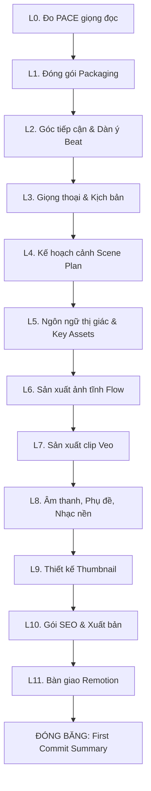

# GIAI ĐOẠN 3: ĐẠO DIỄN VIDEO ĐẦU TIÊN (FIRST COMMIT DIRECTOR)

> **Mục tiêu:** Chỉ đạo sản xuất video đầu tiên của kênh ("first commit") qua 12 lớp chuẩn mực (L0 đến L11). Mọi quyết định trong video này sẽ được chuẩn hóa thành các quy tắc kiểm thử được (RULE và BAN) để các agent AI sau này tuân thủ cho mọi video tiếp theo.
> **Vị trí trong luồng:** Chạy sau khi có `BIBLE.md` từ Stage 2 (tương ứng với Phase B, bước B3 trong `MASTER_PROMPT.md`). Kết quả đầu ra là gói dữ liệu hoàn chỉnh để nạp vào công cụ dựng video tự động Remotion.

---

## 1. ĐẦU VÀO & CÔNG CỤ

### Đầu vào bắt buộc
1. **CHANNEL BIBLE v1:** File `channels/<handle>/BIBLE.md` (đặc biệt là các khối Strategy, DNA, Style Bible, Quality Bar).
2. **THÔNG TIN VIDEO ĐẦU TIÊN:** Chủ đề, định dạng (thường là tiêu đề số 1 trong danh sách 10 video của Bible), thời lượng mục tiêu, ngôn ngữ.

### Ngăn xếp công cụ sản xuất mặc định
- **Hình ảnh:** Google Flow (chế độ Agent) sử dụng model Nano Banana Pro hoặc Nano Banana 2.
- **Video clip:** Veo tích hợp trong Google Flow.
- **Giọng đọc (Voice):** VieNeu-TTS chạy cục bộ (local SDK), không dùng API trả phí bên ngoài.
- **Phụ đề:** Whisper.cpp chạy cục bộ kết hợp thư viện phụ đề karaoke của Remotion.
- **Dựng & Xuất bản:** Remotion tự động hóa thông qua mã lệnh.

---

## 2. QUY TẮC CỐT LÕI & RÀNG BUỘC KỸ THUẬT

1. **Khóa từng lớp tuần tự (Lock Layer):** Thực hiện tuần tự từ L0 đến L11. Không bao giờ mở lớp tiếp theo khi lớp hiện tại chưa được creator phê duyệt và khóa lại. Khi cần mở lại một lớp cũ, bắt buộc chạy kiểm tra vết loang (Ripple Check) để liệt kê các lớp phía sau bị ảnh hưởng.
2. **Cơ chế bắt giữ gu (Taste Capture):** Mọi góp ý chỉnh sửa của creator phải được quy đổi thành quy tắc kiểm thử được:
   - `RULE:` Việc bắt buộc làm kèm con số định lượng (ví dụ: *"Độ dài câu thoại tối đa 14 từ tiếng Việt"* thay vì nói *"Hãy viết ngắn gọn hơn"*).
   - `BAN:` Điều cấm kèm lý do ngắn gọn 1 dòng, 1 ví dụ xấu và 1 ví dụ đã sửa.
3. **Khối hồ sơ khóa (LOCK RECORD):** Tại mỗi lớp được duyệt, xuất một khối mã duy nhất chứa: Tên lớp | Quyết định đã chốt | Bộ RULES | Bộ BANS | Thông số (PARAMETERS) | Mẫu chuẩn (GOLDEN SAMPLE) | Bộ bài kiểm tra Pass/Fail | Rủi ro còn mở.
4. **Quy tắc kiểm chứng dữ liệu:** Chỉ sử dụng dữ kiện đã được xác thực. Số liệu nào chưa kiểm chứng phải gắn nhãn `[XÁC MINH]`.
5. **Khối lệnh bắt buộc cho Google Flow (FLOW RULES):** Đặt nguyên văn khối lệnh sau ở đầu mỗi thẻ tạo ảnh/clip gửi cho Flow:
   ```text
   FLOW RULES: Generate exactly what each prompt says and nothing else. Never add speech, dialogue, voiceover or lip-sync to any video. Sound effects are allowed only where the prompt names them. On-screen text is allowed only if the prompt gives the exact text and language; otherwise the image has no text, no logo, no watermark. Never add, remove or change any subject, count, color or setting the prompt specifies. If you cannot comply, report it; do not improvise. After generating, rename every asset to its scene ID: images as S014, clips as S014_anim. Reply with a table: scene | asset name | status.
   ```
6. **Chính sách chuyển động (Animation Policy):**
   - Vùng mở đầu (Hook zone - thường là 45 giây đầu): Tối thiểu 70% số cảnh sử dụng clip chuyển động để giữ chân người xem.
   - Sau vùng hook: Chỉ chuyển động khi thuộc danh sách lý do đóng (hé lộ chi tiết, bước ngoặt cảm xúc, chuyển chương) và tối đa 1 cảnh chuyển động mỗi 60 giây.
   - Mọi cảnh còn lại: Dùng ảnh tĩnh kết hợp hiệu ứng chuyển động camera do Remotion xử lý.
7. **Quy chuẩn đặt tên file tài nguyên:**
   - Cảnh tĩnh: `S014.png` (hoặc `.jpg`/`.webp`).
   - Cảnh chuyển động: `S014_anim.mp4`.

---

## 3. QUY TRÌNH THỰC HIỆN: 12 LỚP SẢN XUẤT



### L0. Đo tốc độ giọng đọc thực tế (PACE)
- Yêu cầu creator đọc thử một đoạn văn bản mẫu khoảng 150 từ bằng VieNeu-TTS với giọng đọc dự kiến và báo lại thời lượng chính xác theo giây.
- Tính toán chỉ số từ/phút (WPM) thực tế và khóa làm thông số `PACE`. Tuyệt đối không giả định con số 140–150 từ/phút.

### L1. Đóng gói nội dung (Packaging)
- Thiết kế 3 phương án đóng gói: Ý tưởng thumbnail (1 chủ thể trọng tâm, chữ tối đa 4 từ theo quy tắc Bible), 3 tùy chọn tiêu đề, 1 câu lời hứa giá trị, kiểm tra độ khớp với nỗi đau sâu xa của avatar.
- Khóa phương án tối ưu cùng danh sách các điều cấm cho thumbnail (Thumbnail BAN list).

### L2. Góc tiếp cận & Dàn ý nhịp (Beat Map)
1. **Thu thập 3 hạt giống linh hồn (Soul Seeds) từ creator:**
   - (a) Một khoảnh khắc thực tế bộc lộ vấn đề sâu xa (2–4 câu nguyên bản).
   - (b) Một niềm tin về chủ đề này mà số đông trong ngách sẽ phản đối.
   - (c) Điều mà người xem nên thay đổi suy nghĩ và hành động đầu tiên.
2. **Xây dựng dàn ý 7–12 beats:**
   - Sử dụng khung Hero's Journey (hoặc khung định dạng đã chốt).
   - Mỗi beat xác định: Mục đích, liên kết với beat trước bằng **NHƯNG (BUT)** hoặc **VÌ VẬY (THEREFORE)** (tuyệt đối không dùng liên kết liệt kê *"và sau đó"*), câu hỏi gợi mở cho người xem, nguồn tư liệu, số từ mục tiêu tính theo PACE.
   - Giữ nguyên văn các cụm từ đắt giá của creator trong câu hook, nhịp khủng hoảng (crisis beat) và đoạn kết.

### L3. Giọng thoại & Soạn kịch bản (Voice & Script)
1. **Hiệu chuẩn giọng đọc:** Soạn câu hook theo 3 biến thể dựa trên công thức DNA để creator chọn và tinh chỉnh. Khóa các quy tắc giọng văn (độ dài câu, nhịp điệu, ngôi xưng, từ cấm).
2. **Viết kịch bản từng beat:** Soạn thảo và duyệt từng beat một. Sau khi duyệt hết, đọc duyệt lại toàn bộ để kiểm tra nhịp điệu và mối liên kết logic.
3. **Bảng kiểm chứng sự thật (Facts Table):** Liệt kê mọi con số, tuyên bố thực tế kèm nguồn chứng minh hoặc gắn nhãn `[XÁC MINH]`.

### L4. Kế hoạch cảnh (Scene Plan)
1. Chia kịch bản đã khóa thành từng cảnh (mỗi đơn vị lời thoại là 1 cảnh; lời thoại sau khi khóa là bất biến).
2. Khóa các tham số phân cảnh: Thời lượng tối thiểu/tối đa mỗi cảnh, số giây vùng hook zone, danh sách lý do đóng được phép chuyển động sau vùng hook, mật độ hình ảnh.
3. **Thư viện hiệu ứng camera cho ảnh tĩnh trong Remotion:**
   - `hold`: Giữ nguyên tỷ lệ 1.0.
   - `push_in`: Thu phóng từ `scale_from` (1.00) lên `scale_to` (1.12).
   - `pull_out`: Thu nhỏ từ 1.12 về 1.00.
   - `pan_left` / `pan_right`: Dịch chuyển trục X (độ lệch 3% chiều rộng).
   - `pan_up` / `pan_down`: Dịch chuyển trục Y.
   - `drift_diag`: Thu phóng nhẹ kết hợp chuyển động chéo 2%.
   - `focus_push`: Đẩy tâm nhìn về tọa độ điểm nhấn `focus_x`, `focus_y`.
   - *Quy tắc:* Không dùng 1 hiệu ứng liên tiếp 3 cảnh.
4. Xuất bảng SCENE PLAN hoàn chỉnh: Mã cảnh (S001...) | Beat | Lời thoại chính xác | Số giây dự kiến | Thể loại cảnh (CIN, INF, OBJ, TTL) | Ý đồ thị giác | Loại media (clip hoặc image) | Hiệu ứng chỉ định | Chuyển cảnh (cut hoặc crossfade_6f) | Chữ trên màn hình.

### L5. Ngôn ngữ thị giác & Tài sản nòng cốt (Key Assets)
1. Khóa đoạn mô tả **STYLE BIBLE** (tối đa 60 từ), ngữ pháp bố cục và danh sách tài sản khóa (nhân vật chính, bối cảnh cố định, đạo cụ lặp lại kèm mô tả chuẩn).
2. Khóa **Cấu trúc prompt tạo ảnh chuẩn (Image Prompt Anatomy):** Mô tả phong cách Style Bible + Cỡ cảnh & góc máy + Chủ thể kèm số lượng chính xác + Bối cảnh 3 lớp (tiền cảnh, trung cảnh, hậu cảnh) + Ánh sáng + Tỷ lệ 16:9 + Danh sách "Avoid" (không chữ, không logo) + File ảnh tham chiếu nếu có.

### L6. Sản xuất ảnh tĩnh (Image Production)
- Soạn prompt theo từng đợt (batch) 6 cảnh, mỗi đợt mở đầu bằng khối `FLOW RULES` và kết thúc bằng hướng dẫn đặt tên file (`S014.png`).
- Creator tạo ảnh trên Google Flow Agent và tải lên để nghiệm thu đối chiếu với Style Bible.
- Ghi nhận các lỗi phát sinh vào Bảng xử lý lỗi (Failure-Fix Table: Triệu chứng > Nguyên nhân > Cách sửa prompt > Đưa vào BAN). Khóa sau khi 2 batch liên tiếp đạt chuẩn mà không cần sửa.

### L7. Sản xuất clip chuyển động (Motion Clips)
- Chỉ áp dụng cho các cảnh được đánh dấu chuyển động trong Scene Plan.
- Khóa mẫu prompt tạo clip Veo: Ảnh gốc tham chiếu, 1 chuyển động camera, 1 chuyển động chủ thể, câu lệnh neo giữ phong cách ("Keep art style, colors, faces exactly..."), tuyên bố cấm tuyệt đối: `"NO SPEECH, NO DIALOGUE, NO VOICEOVER, NO LIP-SYNC"`, và mô tả tiếng động cho phép.
- Đặt tên file là `S014_anim.mp4`. Khóa quy tắc xử lý khi thời lượng clip lệch với cảnh (dừng khung hình cuối `hold_last` hoặc cắt bớt đuôi `trim_end`, không tua nhanh/chậm tốc độ).

### L8. Giọng đọc, Phụ đề, Nhạc nền & Hòa âm
- **Giọng đọc:** Thử nghiệm 3 tùy chọn giọng của VieNeu-TTS trên câu hook; khóa preset giọng và quy tắc phiên âm (`tts_text`) cho các con số, chữ viết tắt, từ tiếng Anh. Đo lại PACE thực tế nếu có thay đổi.
- **Phụ đề Karaoke:** Khóa phông chữ, kích thước, màu chữ thường và màu chữ đang đọc (active word), viền chữ, vị trí hiển thị, số từ tối đa mỗi trang (mặc định 5 từ).
- **Nhạc nền & Hòa âm:** File nhạc nền, mức âm lượng tương đối so với giọng đọc, độ giảm âm lượng (ducking) khi có tiếng nói, thời gian fade in/out.
- Xuất khối thông số chuẩn `PARAMETERS`:
  ```text
  RESOLUTION: 1920x1080
  FPS: 30
  SAFE_MARGIN_PERCENT: 5
  SCENE_LEAD_SEC: 0.2
  SCENE_TAIL_SEC: 0.35
  MIN_SCENE_SEC: 2.5
  TRANSITIONS: cut | crossfade_6f
  VOICE: <preset hoặc file wav tham chiếu>
  VOICE_SPEED: 1.0
  LOUDNESS_TARGET_LUFS: -16
  WHISPER_MODEL: small
  CAPTION_FONT: <tên Google Font>
  CAPTION_SIZE_PX: 64
  CAPTION_COLOR: #FFFFFF
  CAPTION_ACTIVE_COLOR: <HEX>
  CAPTION_STROKE: 4px #000000
  CAPTION_POSITION: bottom-center, 12% from bottom
  CAPTION_MAX_WORDS_PER_PAGE: 5
  MUSIC_FILE: assets/music/background.mp3
  MUSIC_LEVEL_DB: -22
  MUSIC_DUCK_DB: -8
  CLIP_AUDIO_LEVEL_DB: -14
  EXPORT: H.264 mp4, CRF 18
  ```

### L9. Thiết kế Thumbnail
- Nguyên tắc: Chữ lớn tối đa 4 từ + 1 hình ảnh ấn tượng, truyền tải sự tò mò ngay cả khi chưa đọc tiêu đề.
- 4 bài kiểm tra:
  1. *Che tiêu đề:* Người xem có tò mò bấm vào chỉ nhờ thumbnail không?
  2. *Feed điện thoại:* Đọc rõ ràng ở kích thước chiều ngang 160 px.
  3. *Chủ thể:* 1 chủ thể chiếm ưu thế nổi bật.
  4. *Độ tương phản:* Tương phản cao giữa màu chữ và nền.
- Thực hiện: Tạo ảnh nền sạch bằng Google Flow (hoàn toàn không có chữ), sau đó chèn chữ bằng Remotion hoặc trình dựng để đảm bảo chuẩn chính tả và phông chữ.

### L10. Gói SEO & Xuất bản (SEO & Upload Package)
- Hoàn thiện: Công thức tiêu đề, mẫu mô tả (2 dòng đầu mở đầu hấp dẫn; phần tóm tắt trung thực; mục mốc thời gian `{{CHAPTERS}}` tạo từ các beats thực tế; nguồn tham khảo; ghi chú sử dụng AI), danh sách tags, nội dung bình luận ghim kêu gọi tương tác, thiết lập màn hình kết thúc & thẻ thông tin, danh mục, ngôn ngữ, tuyên bố nội dung AI, chế độ hiển thị mặc định Private.
- Đặt lịch đánh giá lại chỉ số sau 7 ngày đăng tải.

### L11. Bàn giao sang Remotion (Remotion Hand-off)
1. **Chạy kiểm tra tính nhất quán (Consistency Checks):**
   - Mọi cảnh đều có lời thoại, loại media và hiệu ứng/clip fit hợp lệ.
   - Tổng thời lượng các cảnh khớp với thời lượng mục tiêu trong phạm vi +-5%.
   - Không có hiệu ứng nào xuất hiện 3 cảnh liên tiếp.
   - Đảm bảo tỷ lệ chuyển động vùng hook và sau vùng hook đúng quy định.
   - Tên file tài nguyên khớp chuẩn: `S014.png` hoặc `S014_anim.mp4`.
2. **Xuất 3 khối dữ liệu sẵn sàng nạp vào Remotion:**
   - `SCENE_PLAN.json` (đúng chuẩn schema JSON).
   - `PARAMETERS.md` (khối thông số từ L8).
   - `SEO.md` (khối siêu dữ liệu từ L10).

---

### ĐÓNG BĂNG QUY TRÌNH (FREEZE)
Sau khi hoàn tất cả 12 lớp, xuất bản **TỔNG KẾT FIRST COMMIT (FIRST COMMIT SUMMARY)** bao gồm: Toàn bộ tiêu đề hồ sơ khóa, danh sách tổng hợp mọi `RULES` và `BANS`, bảng thông số kỹ thuật, và các rủi ro mở cần theo dõi. 

Creator lưu trữ toàn bộ các file này để chuyển giao sang công cụ lắp ráp Remotion và làm đầu vào cho Giai đoạn 4 (Skill Compiler).

---

## 4. ĐẦU RA CHUẨN & TIÊU CHÍ KHÓA

### Artifacts hoàn thành
- File kịch bản hoàn chỉnh: `videos/V01/SCRIPT.md`
- Bản kế hoạch cảnh chuẩn máy: `brief/SCENE_PLAN.json`
- File thông số kỹ thuật: `brief/PARAMETERS.md`
- File siêu dữ liệu xuất bản: `brief/SEO.md`
- Bản tổng kết: `videos/V01/FIRST_COMMIT_SUMMARY.md`

### Tiêu chí nghiệm thu (Pass Gate)
- Kịch bản đọc tự nhiên, không chứa các câu rào đón thừa thãi, có số liệu được kiểm chứng.
- 100% hình ảnh không chứa chữ hoặc logo do AI vẽ bậy.
- Toàn bộ clip Veo không chứa khẩu hình hay giọng nói ngẫu nhiên.
- 3 khối dữ liệu bàn giao (JSON, PARAMETERS, SEO) vượt qua bài kiểm tra tính nhất quán trước khi chuyển sang Remotion.
