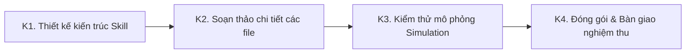

# GIAI ĐOẠN 4: ĐÓNG GÓI BỘ KỸ NĂNG (SKILL COMPILER)

> **Mục tiêu:** Chuyển hóa toàn bộ các quy tắc, thông số kỹ thuật, bài học kinh nghiệm và tài sản mẫu từ Video đầu tiên ("First Commit") thành một **BỘ KỸ NĂNG (SKILL PACKAGE)** hoàn chỉnh. Bộ skill này cho phép các agent AI cấp dưới thực thi sản xuất các video tiếp theo từ một kịch bản đã khóa với chất lượng đồng đều, không phụ thuộc vào suy đoán cá nhân.
> **Vị trí trong luồng:** Chạy độc lập trong một phiên chat mới sau khi Video đầu tiên (Stage 3) đã được sản xuất và nghiệm thu thành công (tương ứng với bước B4 trong `MASTER_PROMPT.md`).

---

## 1. ĐẦU VÀO & CÔNG CỤ

### Đầu vào bắt buộc
1. **CHANNEL BIBLE v1:** File `channels/<handle>/BIBLE.md` đã chốt từ Stage 2.
2. **HỒ SƠ KHÓA (LOCK RECORDS) & TỔNG KẾT FIRST COMMIT:** Toàn bộ hồ sơ các lớp L0 đến L10 từ Stage 3 (bao gồm các quy tắc `RULES`, danh sách cấm `BANS`, bảng thông số `PARAMETERS`, mẫu chuẩn `GOLDEN SAMPLES`, bộ kiểm tra `CHECKS`, và Bảng xử lý lỗi `Failure-Fix Table`).
3. **KỊCH BẢN & BẢN ĐỒ CẢNH:** File `SCRIPT.md` và `SCENE_PLAN.json` đã khóa của video đầu tiên.
4. **DANH MỤC PROMPT HIỆU QUẢ NHẤT:** Các prompt tạo ảnh và chuyển động tốt nhất thực tế đã dùng kèm ghi chú về các lỗi từng gặp.
5. **BA KHỐI DỮ LIỆU BÀN GIAO & BÁO CÁO QA:** File `SCENE_PLAN.json`, `PARAMETERS.md`, `SEO.md` và file `QA_REPORT.md` từ công cụ lắp ráp Remotion.
6. **PROMPT CỦA AGENT LẮP RÁP:** File quy trình lắp ráp Remotion đã thực thi ở video đầu tiên.

### Điều kiện dừng (Stop Condition)
Nếu thiếu bất kỳ tài liệu đầu vào nào trong số trên, phải liệt kê chính xác phần bị thiếu và dừng lại, không được tự ý biên soạn bộ skill.

---

## 2. QUY TẮC CỐT LÕI & NGUYÊN TẮC SOẠN THẢO SKILL

### Giả định về Agent thực thi
Agent AI cấp dưới sẽ sử dụng bộ skill này có các đặc tính:
- Mất ngữ cảnh giữa các tác vụ độc lập.
- Tuân thủ hướng dẫn theo nghĩa đen tuyệt đối.
- Dễ tự ý sáng tác bừa bãi khi gặp chỉ dẫn mơ hồ.
- Không thể tự hỏi người dùng trừ khi có quy tắc quy định chính xác thời điểm và cách thức hỏi.

### 10 Nguyên tắc vàng khi viết Skill (áp dụng cho mọi file)
1. **Câu mệnh lệnh ngắn:** Một chỉ dẫn duy nhất mỗi câu. Không dùng thành ngữ, không dùng các cụm từ mông lung (*"tùy tình huống"*, *"tự đánh giá"*, *"vân vân"*).
2. **Con số định lượng tuyệt đối:** Mọi giới hạn phải bằng số cụ thể (số từ, số giây, tỷ lệ phần trăm, số lượng ảnh). Mọi lựa chọn phải nằm trong danh sách đóng.
3. **Cấu trúc chuẩn 5 bước cho mỗi quy trình:**
   - `ĐỌC (READ):` Đọc chính xác những file nào.
   - `LÀM (DO):` Các hành động được đánh số thứ tự rõ ràng.
   - `XUẤT (PRODUCE):` File đầu ra cụ thể và định dạng chính xác.
   - `KIỂM TRA (CHECK):` Các bài kiểm tra Pass/Fail độc lập.
   - `NẾU THẤT BẠI (IF FAIL):` Cách khắc phục cụ thể hoặc lệnh dừng lại hỏi.
4. **Cặp đôi minh họa:** Mọi `RULE` phải đi kèm 1 dòng lý do và 1 ví dụ tốt. Mọi `BAN` phải đi kèm 1 ví dụ xấu và bản đã sửa đúng chuẩn.
5. **Biểu mẫu điền sẵn:** Các biểu mẫu dùng dấu `<THAY_THẾ>` kèm ví dụ hoàn chỉnh ngay bên cạnh.
6. **Bảng quyết định (Decision Tables):** Thay thế văn xuôi bằng bảng tra cứu cho mọi tình huống lựa chọn.
7. **Danh mục cấm tự chế:** Cấm agent tự ý sửa lời thoại đã khóa, bảng màu, phông chữ, phong cách ảnh, cách đánh số cảnh hay bất kỳ tham số nào.
8. **Quy tắc Dừng và Hỏi (STOP-AND-ASK):** Khi thiếu dữ liệu đầu vào hoặc gặp xung đột quy tắc, agent bắt buộc dừng lại và xuất đúng một dòng thông báo theo cú pháp:
   ```text
   BLOCKED: <nội dung bị thiếu hoặc xung đột> | RULE: <tên file và số điều khoản> | OPTIONS: <Phương án A hoặc B>
   ```
9. **Thứ tự ưu tiên khi xung đột quy tắc:** `BANS` > `CHECKS` > `PARAMETERS` > `RULES` > `TEMPLATES` > Ví dụ minh họa.
10. **Định nghĩa hoàn thành (Definition of Done):** Mỗi bước phải có một danh sách kiểm tra (checklist) để xác nhận công việc đã thực sự xong.

---

## 3. QUY TRÌNH THỰC HIỆN



### Bước K1: Thiết kế kiến trúc bộ Skill (Design)
1. Xác lập cấu trúc thư mục chuẩn được may đo riêng cho kênh từ các quyết định của video đầu tiên:
   ```text
   youtube-video-factory/
     SKILL.md                 # Điểm khởi đầu: mục đích, điều kiện dùng, quy trình tổng quát, quy tắc toàn cục, định nghĩa xong
     references/
       01-input-contract.md   # Định dạng chuẩn của kịch bản đã khóa và bản đồ phân cảnh; các bước kiểm tra đầu vào
       02-voice-rules.md      # Quy chuẩn giọng văn, ngôi xưng, giới hạn câu, công thức hook, từ ngữ cấm
       03-visual-rules.md     # Style Bible, bảng màu HEX, ngữ pháp bố cục, bảng cỡ cảnh, tài sản khóa (key assets)
       04-image-prompting.md  # Cấu trúc prompt ảnh, mẫu điền theo từng thể loại cảnh, bảng xử lý lỗi failure-fix
       05-motion-rules.md     # Mẫu prompt clip chuyển động Veo, các góc máy cho phép, quy tắc không thoại
       06-audio-edit-rules.md # Hướng dẫn giọng đọc, nhạc nền, phụ đề karaoke, kỹ thuật cắt chuyển cảnh
       07-thumbnail-rules.md  # Quy chuẩn thumbnail, mẫu tạo ảnh nền sạch và quy tắc chèn chữ
       08-seo-publish-rules.md# Công thức tiêu đề, mẫu mô tả, mốc thời gian chapters, thẻ tags, bình luận ghim
       09-qa-gates.md         # Các cổng kiểm soát chất lượng Pass/Fail, thang điểm đánh giá, quy trình báo lỗi
       10-golden-example.md   # Mẫu vàng từ First Commit: đối chiếu lời thoại cảnh > prompt ảnh > clip > thông số
       11-failure-catalog.md  # Toàn bộ danh mục lỗi đã gặp, nguyên nhân, cách khắc phục và lệnh cấm BAN tương ứng
       12-flow-agent-rules.md # Quy tắc chạy Google Flow Agent, tên model, quy chuẩn đặt tên file (S014, S014_anim)
       13-scene-plan-rules.md # Quy tắc thời lượng, vùng hook, bảng quyết định chuyển động, schema SCENE_PLAN.json
       14-remotion-assembly.md# Quy trình lắp ráp bằng Remotion: preflight, bản nháp, khóa timeline, render, QA
       15-voice-captions-mix.md# Cài đặt VieNeu-TTS, căn chỉnh phụ đề karaoke Whisper, chuẩn hóa âm lượng LUFS
     templates/               # Các file mẫu điền sẵn cho từng sản phẩm bàn giao
     scripts/                 # (Tùy chọn) Bộ script tự động kiểm tra số từ, tên file, cú pháp JSON
     CHANGELOG.md             # Lịch sử phiên bản của bộ Skill
   ```
2. Xác định danh sách các khoảng trống (Gaps) mà First Commit chưa quyết định để yêu cầu creator chốt trước khi viết.
3. Chờ creator duyệt kiến trúc trước khi viết file.

---

### Bước K2: Soạn thảo chi tiết các file (Draft Files)
1. Soạn thảo tuần tự các file tài liệu trong thư mục `references/` từ `01` đến `15`.
2. Soạn thảo các file mẫu trong `templates/`.
3. Soạn thảo file trung tâm `SKILL.md` sau cùng. File này phải bao gồm:
   - Phần mở đầu YAML frontmatter (`name`, `description`).
   - Mục đích (Purpose), khi nào nên dùng và khi nào KHÔNG được dùng.
   - Hợp đồng đầu vào (Input Contract) & Hợp đồng đầu ra (Output Contract).
   - Quy trình thực hiện chi tiết theo chuỗi: Đọc kịch bản khóa -> Lập Scene Plan -> Viết prompt ảnh Flow -> Viết prompt clip -> Kiểm tra tên file -> Bàn giao sang Remotion -> Xuất bản SEO.
   - Bộ quy tắc toàn cục (Global Rules & Bans).
   - Điều kiện dừng và hỏi (Stop-and-Ask Conditions).
   - Định nghĩa hoàn thành (Definition of Done).

---

### Bước K3: Kiểm thử mô phỏng (Simulation Test)
1. Yêu cầu creator cung cấp một trích đoạn kịch bản ngắn mới (khoảng 10 cảnh), hoặc sử dụng một trích đoạn mẫu thử nghiệm.
2. Đóng vai một agent cấp dưới tuân thủ mệnh lệnh theo nghĩa đen: Thực thi từng bước quy trình chỉ dựa duy nhất vào các file tài liệu trong bộ skill vừa viết, không dùng thêm bất kỳ tri thức bên ngoài nào.
3. Ghi nhận mọi tình huống mà agent phải tự đoán, tự diễn giải hoặc phân vân không có quy tắc rõ ràng: Mỗi trường hợp như vậy được tính là một **LỖI (DEFECT)**.
4. Chấm điểm kết quả đầu ra theo tiêu chí trong `09-qa-gates.md`.
5. Vá lại các file trong bộ skill để triệt tiêu hoàn toàn các lỗi vừa phát hiện. Lặp lại cho đến khi một lượt thực thi hoàn chỉnh đạt **0 LỖI (Zero Defects)**. Báo cáo số lỗi đã phát hiện và sửa chữa.

---

### Bước K4: Đóng gói & Bàn giao nghiệm thu (Final Package)
1. Xuất bản toàn bộ các file của bộ Skill thành gói hoàn chỉnh.
2. Cung cấp bài kiểm tra chấp thuận (Acceptance Test) cho creator: Hướng dẫn cách giao việc cho một agent AI thật, thang điểm đánh giá và danh sách các hạng mục bắt buộc creator phải kiểm tra bằng mắt.
3. Thiết lập vòng lặp học hỏi (Learning Loop): Hướng dẫn creator cách ghi nhận lỗi mới vào `lessons.md` theo cấu trúc: `Triệu chứng > Nguyên nhân > Cách sửa > Lệnh cấm BAN mới`, và cách nâng số hiệu phiên bản trong `CHANGELOG.md`.

---

## 4. ĐẦU RA CHUẨN & TIÊU CHÍ KHÓA

### Artifacts hoàn thành
- Gói thư mục kỹ năng hoàn chỉnh: `youtube-video-factory/` đầy đủ các file quy chuẩn và mẫu biểu.
- Bản hướng dẫn kiểm thử chấp nhận dành cho creator.
- Cơ chế cập nhật bài học kinh nghiệm (`lessons.md` và `CHANGELOG.md`).

### Tiêu chí nghiệm thu (Pass Gate)
- Bộ skill vượt qua bài kiểm thử mô phỏng với 0 lỗi suy đoán (Zero Defects).
- Toàn bộ các quy tắc đều có tiêu chí kiểm tra Pass/Fail rõ ràng.
- Đầy đủ cơ chế dừng và hỏi (Stop-and-Ask), không để agent cấp dưới tự biên tự diễn khi gặp sự cố.
